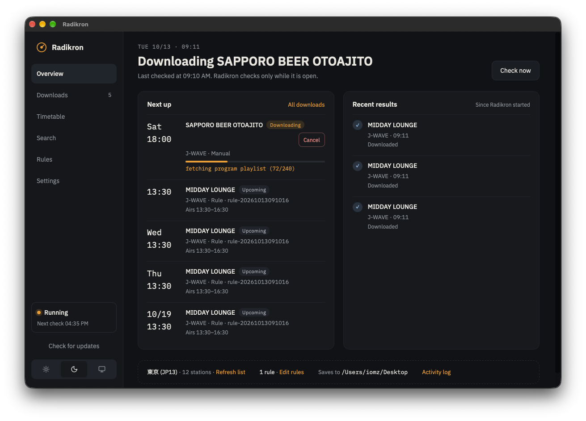
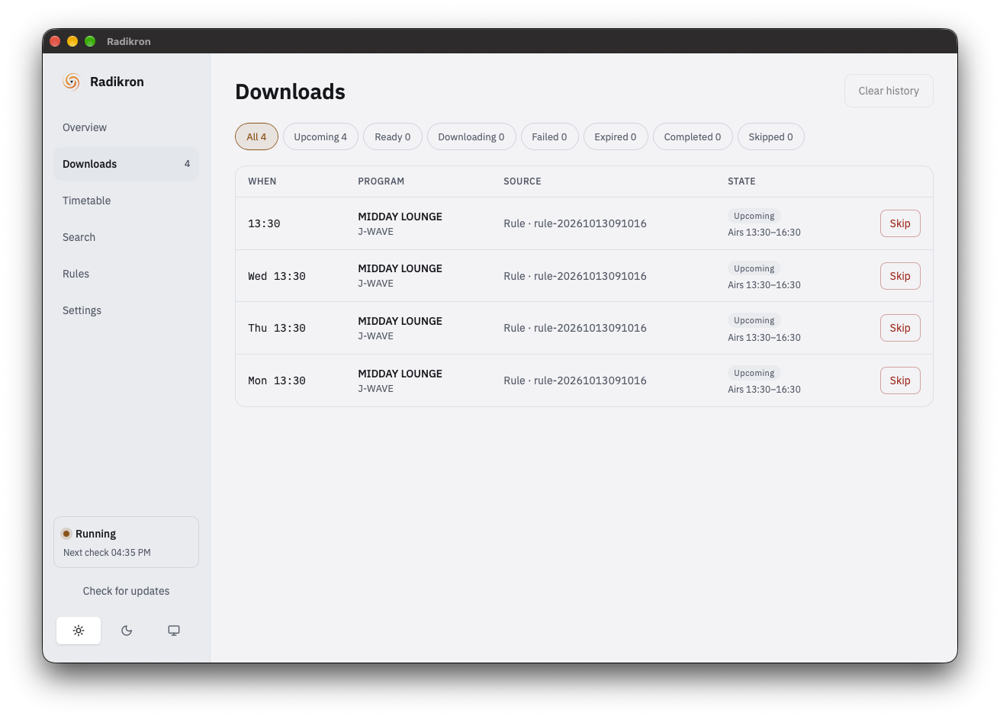

<div align="center">

<picture>
  <source media="(prefers-color-scheme: dark)" srcset="cmd/radikron-gui/build/appicon.svg">
  
</picture>

# Radikron

Keep your favorite radiko.jp shows before they leave the timeshift.

[](https://github.com/iomz/radikron/releases/latest)
[](https://github.com/iomz/radikron/actions/workflows/build.yml)
[](https://github.com/iomz/radikron/actions/workflows/docker.yml)
[](https://codecov.io/gh/iomz/radikron)
[](https://pkg.go.dev/github.com/iomz/radikron)
[](LICENSE)

</div>

Sometimes we miss our favorite shows on [radiko.jp](https://radiko.jp/) and they get vanished from <http://radiko.jp/#!/timeshift> – let's just keep them automatically saved in your local disk, from AoE.

**Disclaimer**:

- Never use this program for commercial purposes.

---

<!-- vim-markdown-toc GFM -->

- [Features](#features)
  - [🖥️ Dual Interface Support](#dual-interface-support)
  - [🎯 Smart Rule-Based Matching](#smart-rule-based-matching)
  - [📁 Flexible File Organization](#flexible-file-organization)
  - [🛡️ Intelligent Download Management](#intelligent-download-management)
  - [➕ Manual Program Injection](#manual-program-injection)
  - [🌐 Multi-Region & Continuous Monitoring](#multi-region-continuous-monitoring)
  - [🖱️ GUI Features](#gui-features)
  - [🐳 Docker Support](#docker-support)
- [Requirements](#requirements)
  - [Installing FFmpeg on Windows](#installing-ffmpeg-on-windows)
- [Installation](#installation)
  - [CLI Version](#cli-version)
  - [GUI Version](#gui-version)
- [Configuration](#configuration)
  - [Configuration Options](#configuration-options)
  - [Rule Configuration](#rule-configuration)
  - [Example Configuration](#example-configuration)
  - [ID3 Tags](#id3-tags)
- [Usage](#usage)
  - [CLI Usage](#cli-usage)
  - [GUI Usage](#gui-usage)
  - [Try with Docker](#try-with-docker)
- [Build the image yourself](#build-the-image-yourself)
- [Credit](#credit)

<!-- vim-markdown-toc -->

## Features

radikron is a powerful, automated radio program downloader for [radiko](https://radiko.jp/) available in both **CLI** and **GUI** versions. Both versions share the same core logic, ensuring consistent behavior and reliability.

### 🖥️ Dual Interface Support {#dual-interface-support}

- **CLI Version**: Lightweight command-line interface for servers and automation
- **GUI Version**: Modern graphical interface built with Wails v3 (beta) for desktop users
- **Shared Core**: Both versions use the same engine, ensuring consistent behavior

### 🎯 Smart Rule-Based Matching {#smart-rule-based-matching}

Flexible rules to automatically capture programs using multiple criteria: title/keyword matching, performer filtering, station selection, day-of-week and time-window filters.

### 📁 Flexible File Organization {#flexible-file-organization}

- Rule-based folder organization with configurable download directories
- Support for AAC (default) and MP3 formats
- Automatic ID3 tagging with program metadata

### 🛡️ Intelligent Download Management {#intelligent-download-management}

- Duplicate detection and file size validation
- Automatic retry with exponential backoff for failed downloads
- Concurrent downloads and automatic cleanup of stale failures

### ➕ Manual Program Injection {#manual-program-injection}

Manually add any program to the download queue (past or future), with persistent storage and automatic retry. GUI users can easily manage injections through the interface.

### 🌐 Multi-Region & Continuous Monitoring {#multi-region-continuous-monitoring}

- Area-based station filtering with support for extra stations from other regions
- Continuous background monitoring with scheduled fetching
- Graceful shutdown that waits for active downloads

### 🖱️ GUI Features {#gui-features}

- **Overview**: when the next check runs, what downloads next, and recent results
- **Downloads**: every scheduled program with its state; cancel, skip, or undo a skip, and clear the history
- **Timetable**: each station's broadcast day, colored by download state
- **Search**: find programs in radiko's past and coming week as you type, then download, schedule, or turn one into a rule
- **Rules**: edit rules with a live preview of the programs they match
- **Settings**: download folder, format, area and stations, import and export the config file, and the activity log
- Light and dark themes, and updates from GitHub Releases




### 🐳 Docker Support {#docker-support}

Pre-built Docker images with all dependencies included, ready for easy deployment.

## Requirements

### Common Requirements

- **[FFmpeg](https://ffmpeg.org/download.html)**: Required to combine m3u8 chunks to a single AAC file (or convert to MP3). Make sure `ffmpeg` exists in your `$PATH`. On macOS, Radikron also checks standard Homebrew locations (`/opt/homebrew/bin` and `/usr/local/bin`), including for apps launched from Finder.
  - The [docker image](#try-with-docker) already contains all the requirements including FFmpeg.

### Installing FFmpeg on Windows

The recommended option is the FFmpeg Essentials build from [Gyan's Windows builds](https://www.gyan.dev/ffmpeg/builds/), installed with Windows Package Manager:

```powershell
winget install "FFmpeg (Essentials Build)"
```

Radikron locates `ffmpeg.exe` through the process `PATH`. After installation, open a **new** PowerShell window and verify discovery:

```powershell
Get-Command ffmpeg
ffmpeg -version
```

Close and reopen Radikron after installing FFmpeg so it inherits the updated `PATH`. If `Get-Command ffmpeg` cannot find it, add the FFmpeg `bin` directory containing `ffmpeg.exe` to your Windows user `PATH`, then reopen both PowerShell and Radikron. FFmpeg is needed when Radikron combines downloaded audio segments; it is not bundled with the Radikron GUI.

### GUI-Specific Requirements (for building from source)

If you're building the GUI version from source (Linux users), you'll also need:

- **Go 1.26+**
- **Node.js 20+ and pnpm 10+**
- **Wails v3 CLI**: Install with `go install github.com/wailsapp/wails/v3/cmd/wails3@v3.0.0-beta.28`
- **GTK4 and WebKitGTK 6.0** development packages on Linux: `sudo apt install build-essential pkg-config libgtk-4-dev libwebkitgtk-6.0-dev` on Ubuntu

**Note**: macOS and Windows users can download pre-built binaries and don't need these build tools.

## Installation

### CLI Version

Install the command-line version:

```bash
go install github.com/iomz/radikron/cmd/radikron@latest
```

### GUI Version

#### macOS and Windows Users

Pre-built binaries are available for macOS and Windows. Download the latest release from the [Releases page](https://github.com/iomz/radikron/releases):

- **macOS**: Download `radikron-gui_darwin_arm64-installer.dmg` (Apple Silicon) or `radikron-gui_darwin_amd64-installer.dmg` (Intel)
- **Windows**: Download `radikron-gui_windows_amd64.exe` (x64) or `radikron-gui_windows_arm64.exe` (ARM64)

The `radikron-gui_darwin_*.app.zip` assets contain the same app and are intended for automatic updates.
The macOS app requires macOS 12 or later.

macOS downloads are ad-hoc signed but not notarized. Gatekeeper may require manual approval: only if you downloaded Radikron from the official Releases page, Control-click `Radikron.app`, choose **Open**, then confirm **Open**. The app is not signed with a paid Apple Developer ID.

#### Updating the GUI

On macOS and Windows, the GUI checks for a new release when it starts and once a day while it runs, and shows a notification when one is available.
Choose **Update…** in the notification, the update button in the header, or **Radikron > Check for Updates…** on macOS to open the update window.
The window downloads the update and keeps it only if its `.sig` verifies against the release key built into Radikron (see [Verifying Downloads](#verifying-downloads)).
Choose **Restart & Apply** to restart into the new version, or **Close** to keep running the current one.
The background check never downloads anything.
On macOS, the app updates itself only when it runs as `Radikron.app` from a writable location such as `/Applications`, not from the mounted DMG.
Builds from source on Linux do not update themselves.

#### Verifying Downloads

Every release asset has a matching `.sig` file: an ECDSA P-256 signature over the asset's SHA-256 digest.
Verify a download against the public key in this repository:

```bash
curl -fsSLO https://raw.githubusercontent.com/iomz/radikron/main/internal/releasekey/public_key.pem
asset="radikron-gui_darwin_arm64-installer.dmg"
openssl dgst -sha256 -verify public_key.pem -signature "$asset.sig" "$asset"
```

`checksums.txt` lists the SHA-256 digests of all assets and is signed the same way.

#### Linux Users

Linux users need to build from source. See the [GUI README](cmd/radikron-gui/README.md) for detailed setup instructions.

**Quick start for building on Linux**:

```bash
# Install frontend dependencies
cd cmd/radikron-gui/frontend
pnpm install

# Return to GUI directory
cd ..

# Run in development mode
wails3 dev

# Or build for production
wails3 build
```

## Configuration

Create a configuration file (`config.yml`) to define rules for recording. The configuration supports various options to customize your download behavior:

### Configuration Options

- **`area-id`**: Your region code (e.g., `JP13` for Tokyo). If unset, defaults to your detected region.
- **`file-format`**: Output audio format - `aac` (default) or `mp3`.
- **`downloads`**: Directory path for downloaded files (default: `$HOME/Downloads/radiko` on all platforms).
- **`extra-stations`**: List of station IDs to include even if they're not in your region.
- **`ignore-stations`**: List of station IDs to exclude from monitoring.
- **`minimum-output-size`**: Minimum file size in MB (default: 1 MB). Files smaller than this are rejected as potentially corrupted.
- **`max-downloading-concurrency`**: Maximum number of concurrent download operations (default: 64). Only included in config if different from default.
- **`max-encoding-concurrency`**: Maximum number of concurrent MP3 encoding operations (default: 2). Set lower than downloading concurrency since encoding is CPU-intensive. Only included in config if different from default.

NHK stations whose Radiko archives/timeshift audio is unavailable are excluded automatically from station discovery, search, monitoring, and scheduling.
Unsupported station IDs are `JOIK`, `JOHK`, `JOAK`, `JOCK`, `JOBK`, `JOFK`, `JOZK`, `JOLK`, and `JOAK-FM`.
Configuration loading fails with a clear error if one appears in `extra-stations` or a rule's `station-id`; adding these IDs to `ignore-stations` is no longer necessary.
Commercial stations and Radio NIKKEI `RN1`/`RN2` remain supported.
Radiko metadata currently reports `timefree=1` for these NHK stations, so Radikron uses an explicit built-in list instead of runtime capability detection.
Unknown station IDs remain supported to avoid blocking new commercial stations; maintainers must review the built-in list when Radiko changes its station catalog or archive availability.

### Rule Configuration

Each rule can use one or more of the following matching criteria (all support partial matching):

- **`title`**: Match programs by title
- **`keyword`**: Match programs containing the keyword in title or description
- **`pfm`**: Match programs by personality/performer name
- **`station-id`**: Filter by specific station (also adds the station to watch list if not in your region)
- **`dow`**: Filter by day of week (e.g., `mon`, `tue`, `wed`, `thu`, `fri`, `sat`, `sun`)
- **`window`**: Time window filter in hours or minutes (e.g., `48h` for the last 48 hours, `168h` for the last 7 days)
- **`exclude`**: (Optional) Reject programs that would otherwise match (see below)
- **`folder`**: (Optional) Organize downloads for this rule into a subfolder of the download directory, or into another directory when given an absolute path

Rules are evaluated with AND logic - a program must match all specified criteria in a rule.

#### Excluding Programs

A rule can carve out programs it would otherwise match by nesting an `exclude` block. It accepts the same program properties as the matching criteria: `title`, `keyword`, `pfm`, `station-id`, and `dow`.

```yaml
rules:
  midday:
    folder: "MIDDAY LOUNGE"
    station-id: FMJ
    title: "MIDDAY LOUNGE"
    exclude:
      pfm: "GUEST NAME" # skip episodes hosted by this performer
      dow: [sat] # skip the Saturday edition
```

Exclusion uses OR logic, the opposite of the matching criteria: a program is rejected when **any** single criterion under `exclude` matches. An empty or absent `exclude` block rejects nothing.

Because the first matching rule wins, excluding a program from an earlier rule lets a later rule pick it up. This is how a special edition is routed to its own folder:

```yaml
rules:
  midday:
    folder: "MIDDAY LOUNGE"
    title: "MIDDAY LOUNGE"
    exclude:
      title: "SPECIAL"
  midday-special:
    folder: "SPECIALS"
    title: "MIDDAY LOUNGE SPECIAL"
```

**Important**: Rule order matters! When a program matches multiple rules, the first matching rule (in the order they appear in your config file) determines which folder the file is saved to. This allows you to prioritize certain rules by placing them earlier in your configuration.

### Example Configuration

```yaml
area-id: JP13 # if unset, default to "your" region
file-format: aac # audio format: aac or mp3, default is aac
downloads: ~/Downloads/radiko # download directory path, default is "$HOME/Downloads/radiko"
extra-stations:
  - ALPHA-STATION # include stations not in your region
ignore-stations:
  - LFR # exclude an otherwise supported station from monitoring and search
minimum-output-size: 2 # do not save an audio below this size (in MB), default is 1 (MB)
# max-downloading-concurrency: 64  # Maximum concurrent download operations (default: 64)
# max-encoding-concurrency: 2  # Maximum concurrent encoding operations for MP3 conversion (default: 2)
rules:
  midday: # name your rule as you like
    folder: "MIDDAY LOUNGE" # (optional) organize downloads into subfolders
    station-id: FMJ # (optional) the station_id, if not available by default, automatically add this station to the watch list
    title: "MIDDAY LOUNGE" # this can be a partial match
  citypop:
    keyword: "シティポップ" # search by keyword (also a partial match)
    window: 48h # only within the past window from the current time
  hiccorohee:
    pfm: "ヒコロヒー" # search by pfm (i.e., the DJ/MC)
  trad:
    dow: # filter by day of the week (e.g, Mon, tue, WED)
      - wed
      - thu
    station-id: FMT
    title: "THE TRAD"
    exclude: # (optional) reject programs that would otherwise match
      keyword: "再放送" # any single criterion here is enough to skip the program
```

The base directory for downloads defaults to `$HOME/Downloads/radiko` (cross-platform: `~/Downloads/radiko` on Unix/macOS, `%USERPROFILE%\Downloads\radiko` on Windows). If the home directory cannot be determined, it falls back to `./radiko` in the current working directory.

### ID3 Tags

All downloaded audio files (both AAC and MP3) are automatically tagged with ID3v2 metadata:

- **Title**: File base name (format: `YYYY-MM-DD-HHMM_StationID_ProgramTitle`)
- **Artist**: Program personality/performer (`pfm`)
- **Album**: Program title
- **Year**: Program start year
- **Comment**: Program information (`info`)
- **Album Artist**: Rule name (if the program matched a rule)

These tags are embedded in both AAC and MP3 files, making it easy to organize and identify your downloaded programs in music players and media libraries.

## Usage

### CLI Usage

**Basic Usage**:

Radikron automatically saves radiko.jp timeshift programs matching your configured rules. Run it with your configuration file:

```bash
radikron --config config.yml
```

By default, radikron will use `$HOME/Downloads/radiko` as the download directory. Temporary files are stored in the system temporary directory.

**Note**: radikron automatically creates all necessary directories (download directories, subfolders, and temporary directories) when needed. You don't need to create them manually.

The application will:

- Connect to radiko and authenticate
- Fetch program schedules for all monitored stations
- Match programs against your configured rules
- Download matching programs automatically
- Tag files with ID3 metadata
- Continue monitoring and downloading on a schedule

**Command-Line Options**:

- **`-h`, `--help`**: Show help and exit
- **`-c`, `--config <file>`**: Read configuration from the specified file (default: `config.yml`)
- **`-d`, `--debug`**: Include source locations and update-check errors in logs
- **`-v`, `--version`**: Print version and exit
- **`--check-update`**: Check for a newer GitHub release and exit
- **`--self-update`**: Download the latest release, verify its signature, replace the running executable, and exit
- **`--no-update-check`**: Skip the startup update check

Existing single-hyphen options, including `-check-update`, `-self-update`, and `-no-update-check`, remain supported.

**Updates**:

At startup, radikron checks GitHub Releases once and logs a line when a newer version exists.
It never installs anything on its own; run `radikron --self-update` to update, then restart radikron.
The update is installed only if its archive's `.sig` verifies against the release key built into radikron (see [Verifying Downloads](#verifying-downloads)).
Docker images disable `--self-update`; pull a new image instead.

**Running as a Service**:

radikron is designed to run continuously. It automatically:

- Schedules the next fetch time based on program availability
- Waits for downloads to complete before checking again
- Handles interruptions gracefully (waits for in-progress downloads on shutdown)

For production use, consider running it as a systemd service or using a process manager like `supervisord`.

### GUI Usage

The GUI version provides a visual interface for managing radikron:

1. **Launch the application**: Radikron loads your config file and checks radiko for programs your rules match while it is open
2. **Set up**: Choose the download folder, format, and area in **Settings**, or import an existing `config.yml` with **Import config…**
3. **Add rules**: Create rules in **Rules**; the editor previews the programs each rule matches
4. **Find programs**: Search radiko's past and coming week in **Search** and download or schedule a single program, or create a rule from it
5. **Follow downloads**: See what is scheduled, downloading, done, or failed in **Downloads** and **Timetable**; skip a program to keep rules from downloading it
6. **Check activity**: The activity log at the bottom of **Settings** shows what Radikron has done

The GUI shares the same configuration format and behavior as the CLI version, so you can use the same `config.yml` file with both interfaces.

For detailed GUI setup and development instructions, see the [GUI README](cmd/radikron-gui/README.md).

### Try with Docker

[](https://github.com/iomz/radikron/pkgs/container/radikron)

Docker Compose reads `compose.yaml`. It mounts `./config.yml` read-only and stores downloads in `./radiko`. Create the configuration file and download directory before starting:

```console
cp config.yml.template config.yml
mkdir -p radiko
```

Edit `config.yml` to set your rules. Keep `downloads: /radiko` for the container. The container runs as UID/GID `1000:1000` by default; ensure that user can write to `./radiko`. To use your host UID/GID instead:

```console
export RADIKRON_UID=$(id -u)
export RADIKRON_GID=$(id -g)
```

Start the service:

```console
docker compose up
```

To update, pull the new image and recreate the container (`--self-update` is disabled in the image):

```console
docker compose pull
docker compose up -d
```

## Build the image yourself

In case the [image](https://github.com/iomz/radikron/pkgs/container/radikron) is not available for your platform:

```console
docker compose build
```

To update a self-built image, pull the latest source and rebuild:

```console
git pull
docker compose up -d --build
```

## Credit

This project started off from [yyoshiki41/go-radiko](https://github.com/yyoshiki41/go-radiko) and [yyoshiki41/radigo](https://github.com/yyoshiki41/radigo), and therefore follows the [GPLv3 License](https://github.com/yyoshiki41/radigo/blob/main/LICENSE).
